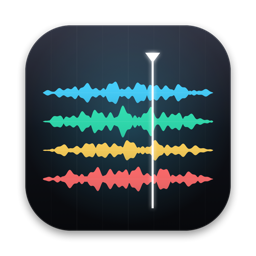
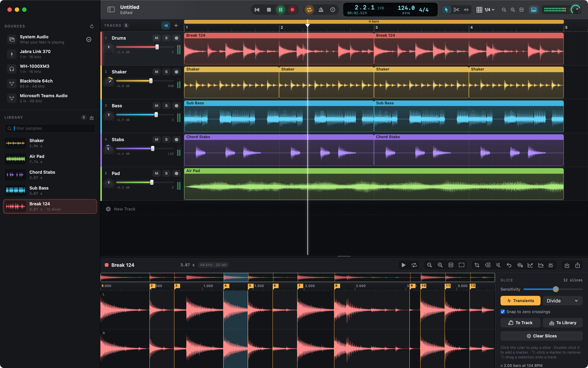
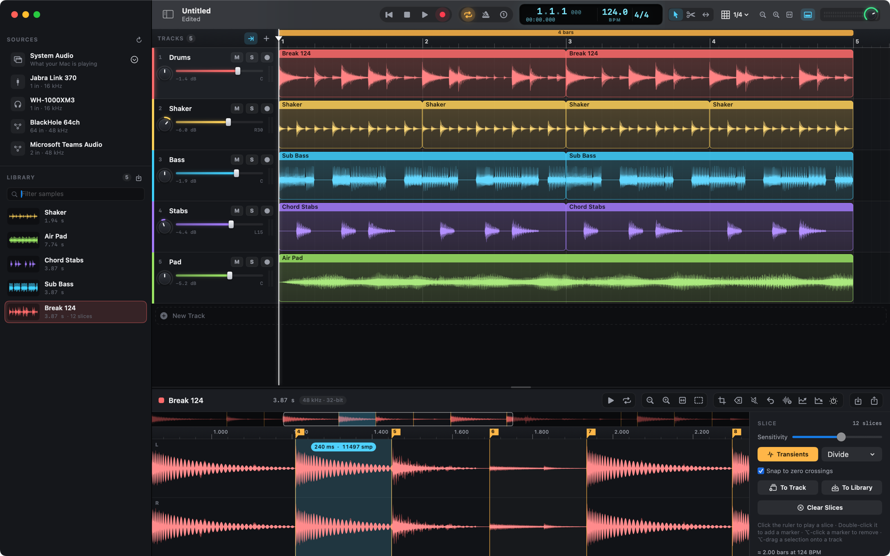
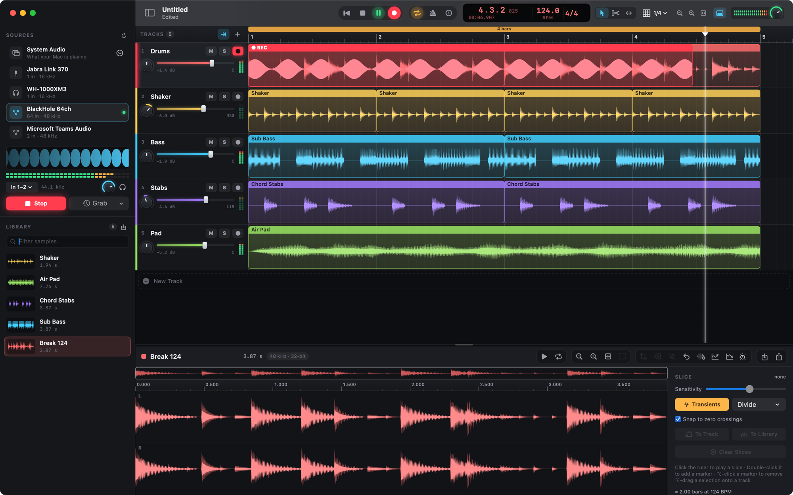
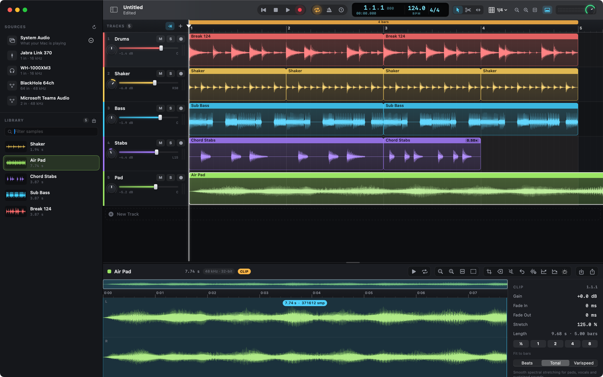
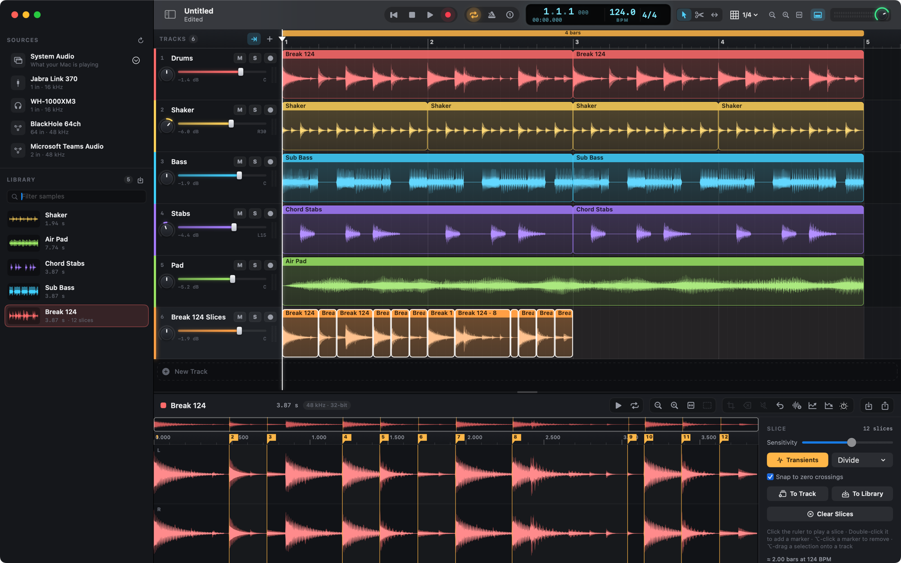
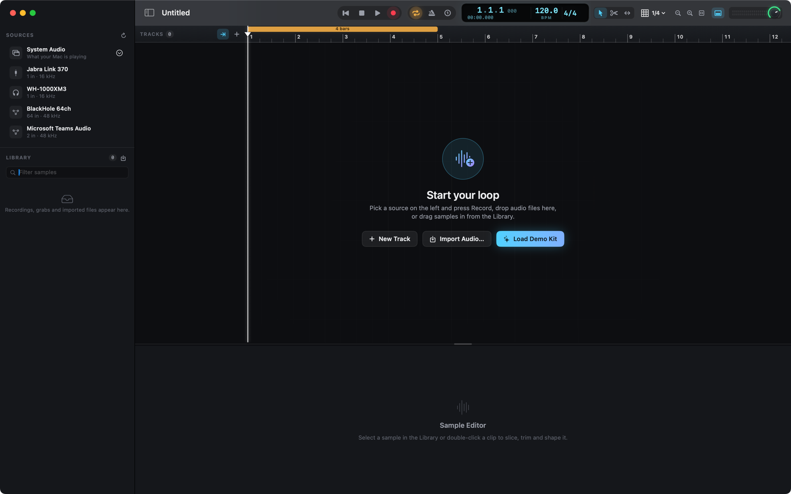

<p align="center">
  
</p>

# Strata

A native macOS sample & loop studio. Capture audio from any input device, instrument
or straight from what your Mac is playing, slice it into pieces, and build stacked,
looping arrangements on a timeline.



**Requirements:** macOS 15 Sequoia or later. Builds with Swift 5.7+ (Xcode 14.2 or newer).

## Build & run

```sh
scripts/build-app.sh          # release build → build/Strata.app
scripts/build-app.sh debug    # debug build
open build/Strata.app
```

The script compiles the Swift package, renders the app icon, assembles the bundle and
signs it with the hardened runtime and App Sandbox (ad-hoc unless you set a signing
identity, see [Permissions](#permissions)). You can also open `Package.swift` in Xcode.

| Variable | Effect |
|---|---|
| `STRATA_SIGN_IDENTITY` | Code-signing identity (default: ad-hoc `-`). A stable identity keeps privacy grants across rebuilds. |
| `STRATA_BUILD_DIR` | Output folder instead of `./build`, e.g. to build while Strata is running. |
| `STRATA_UNSANDBOXED=1` | Debug builds only; used by `scripts/screenshots.sh`. Refused for release. |

### Development

```sh
swift test                    # unit tests: stretch timing, slicing, tempo, clip remapping, file I/O, mixer
scripts/screenshots.sh        # regenerate docs/screenshots (STRATA_SCREENSHOT_DIR=… to preview elsewhere)
```

`scripts/screenshots.sh` builds an unsandboxed debug copy in a temporary folder and drives
it through scripted scenes using the demo kit and a synthetic input signal. The app
captures its own window, so no Screen Recording or Microphone permission is needed. That
scripting hook is compiled out of release builds.

```
Sources/Strata/        App, Model, Audio, Studio (controller), UI
Sources/StrataAtomics/ C11 atomics shared by the audio thread and UI
Tests/StrataTests/     XCTest suite
Resources/             Info.plist, entitlements (sandboxed + dev-only unsandboxed)
scripts/               build-app.sh, screenshots.sh, make-icon.swift
docs/screenshots/      README images
```

### Permissions

Strata runs in the **App Sandbox** with only three entitlements:

| Entitlement | Why |
|---|---|
| `com.apple.security.app-sandbox` | Isolates the app; it can't touch files, network or hardware it wasn't granted. |
| `com.apple.security.device.audio-input` | Recording and monitoring input devices. |
| `com.apple.security.files.user-selected.read-write` | Projects and audio you open, save, import, export or drag in. |

No network, camera, Bluetooth, contacts, Accessibility, Input Monitoring or Full Disk Access.
Settings and autosaves live in `~/Library/Containers/com.griffio.strata`.

- **Microphone** is requested the first time you select an input device.
- **Screen & System Audio Recording** is requested only when you select *System Audio*.
  After turning Strata on in System Settings › Privacy & Security, relaunch Strata
  (the sidebar offers a *Relaunch Strata* button). macOS only applies the grant to new processes.

macOS ties these grants to the app's code signature. The default ad-hoc signature changes
on every build, so a rebuilt app is treated as new and asks again. To keep grants across
rebuilds, sign with a stable identity:

```sh
security find-identity -v -p codesigning          # list available identities
STRATA_SIGN_IDENTITY="Apple Development: you@example.com" scripts/build-app.sh
```

A free Apple ID added in Xcode ▸ Settings ▸ Accounts provides an *Apple Development*
certificate. A self-signed code-signing certificate from Keychain Access ▸ Certificate
Assistant also works for local use.

## Screenshots

| | |
|---|---|
|  |  |
| **Sample editor:** transient slices, zero-crossing selection, sample-accurate zoom. | **Loop recording:** an armed track records exactly one loop cycle from the live input, with a scope and meters for the source. |
|  |  |
| **Time-stretch:** per-clip Beats / Tonal / Varispeed modes, fit-to-bars, live stretch badge. | **Slices → Track:** chop a break and lay the slices out on a new track for re-sequencing. |



## What it does

**Sources (sidebar)**
- Every Core Audio input (built-in mics, USB/Thunderbolt interfaces, Bluetooth,
  virtual devices) plus **System Audio**, either all apps or a single app (ScreenCaptureKit).
- Choose mono or stereo channel pairs on multichannel interfaces, set input gain,
  and monitor the input through the output.
- Live scrolling scope + segmented stereo meter.
- **Grab**: Strata always keeps the last 60 s of the active source. Grab pulls the last
  5–60 s into the Library after the fact.
- **Record**: with no armed track, record a free take into the Library. With an armed
  track, recording follows the timeline. When the loop is on it records exactly one cycle
  (optionally after a one-bar count-in), then plays the take straight back like a looper.

**Timeline**
- Stacked tracks with colour, mute/solo/arm, pan knob, fader, meters, resizable heights.
- Clips: move (across tracks too), trim edges, **stretch** (⌥-drag an edge, the bottom-corner
  grips or the Stretch tool), fade handles, blade tool, ⌥-drag to duplicate, rubber-band
  selection, split, repeat, quantize, "stretch to fit 1/2/4/8 bars".
- Three stretch modes per clip:
  - **Beats**: WSOLA, transient-tight, no drift. Best for drums and loops.
  - **Tonal**: spectral, via AVAudioUnitTimePitch. Best for pads and vocals.
  - **Varispeed**: tape-style, pitch follows speed.
- Loop brace in the ruler (draw/move/resize, double-click toggles), snap grid,
  metronome, tempo and time signature, follow playhead, ⌘-scroll/pinch zoom.
- Drag samples from the Library or audio files from Finder onto any lane.

**Sample editor**
- Stereo waveform with an overview strip. Zooms from the whole file down to individual
  samples, with RMS + peak rendering and optional zero-crossing snap.
- Destructive edits (trim, delete, silence, reverse, normalize, fades, gain), cut / copy /
  paste (also between projects) and insert silence, all undoable. Timeline clips that use
  the sample are remapped, so they keep playing the same audio; a clip spanning a paste is
  split around the new audio.
- Keyboard editing: ← / → jump between slices (⇧ extends the selection), Tab / ⇧Tab step
  through transients, [ / ] nudge the selection edge to the next zero crossing.
- Preview the selection one-shot or looped. A looping preview follows the selection live:
  drag a new region or adjust an edge and playback moves to it without stopping.
- Slicing: automatic transient detection with a sensitivity control, equal divisions,
  beat-grid slicing, and manual markers. Click a slice in the ruler to audition it
  (MPC-style). Send slices to a new track or to the Library, or ⌥-drag a selection
  onto a track.
- Tempo detection for the sample or selection. Loops snap to an exact whole number of bars
  (½× / 2× for half or double time); set the project tempo from it, or stretch the sample's
  clips to play in time at the project tempo.
- Clip inspector: gain, fades, stretch %, fit-to-bars, stretch mode.

**Project & export**
- Document-based (`.strata` packages: JSON + bit-exact 32-bit float CAF audio), with autosave,
  versions, full undo/redo.
- Export the mixdown (loop or whole song) or individual samples as 24-bit WAV/AIFF.
  Bounce the loop back into the Library. Bounces render pitch-preserving stretches at
  full quality, even if they are still processing for playback.
- Launch opens a new project. Closing the last window keeps Strata running, and clicking
  the Dock icon opens a new project.

Help ▸ **Load Demo Kit** synthesises a small kit (drums, bass, chords, pad, shaker) so you
can try everything without a mic.
Help ▸ **Keyboard Shortcuts** (⌘/) lists the shortcuts: Space play, R record, L loop,
K metronome, S split, V/B/T tools, M add slice, P preview, Z zoom to fit…

## Architecture

| Layer | Notes |
|---|---|
| `Model/` | `Project` is a value type, so undo is a snapshot swap. `SampleBuffer` holds immutable audio in unmanaged memory with a multi-resolution min/max/RMS peak pyramid. File I/O, document packages, transient detection. |
| `Audio/PlaybackEngine` | `AVAudioSourceNode` render callback. Each arrangement change produces a new `RenderGraph` of plain-old-data structs, handed to the audio thread through a try-lock slot (no locks, allocation or ARC on the audio thread). Sample-accurate looping, 4-point Hermite varispeed, auto de-click, smoothed gain/pan, metronome, soft-clip safety. |
| `Audio/CaptureService` | Hardware input via `AVAudioSinkNode` and system audio via ScreenCaptureKit both feed a lock-free SPSC ring buffer. A 5 ms consumer converts to 48 kHz and fans out to meters, scope, grab history, monitor ring and the recorder. Host-time stamps give latency-compensated timeline placement. |
| `Audio/TimeStretcher` | WSOLA and spectral engines, rendered offline and cached per clip region and ratio. Clips play as varispeed while a render is in flight or a drag is in progress. |
| `Studio/` | Per-window controller: transport, undo, editing, slicing, recording. |
| `UI/` | SwiftUI shell plus custom AppKit/Core Graphics views for the lanes, ruler and waveform editor. All custom controls expose VoiceOver labels, values and adjust actions; animations respect Reduce Motion. |

**Energy:** the output engine starts on demand and stops after a few idle seconds, the UI
refresh drops from 60 Hz to 4 Hz when nothing is moving, and hidden (occluded) windows stop
redrawing.
