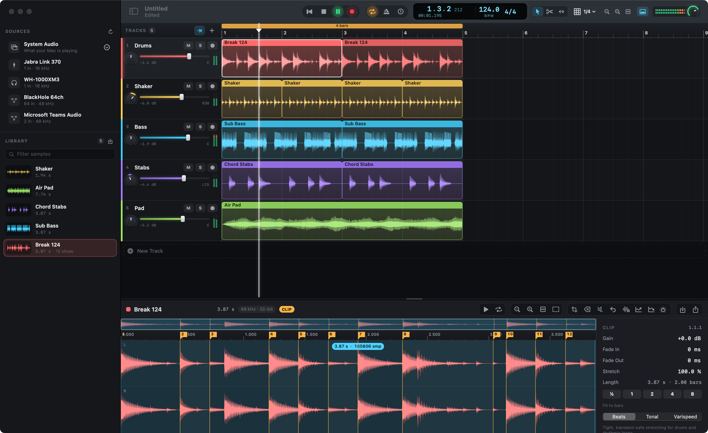

# Strata

A native macOS sample & loop studio. Capture audio from any input device, instrument
or straight from what your Mac is playing, slice it into pieces, and build stacked,
looping arrangements on a timeline.



**Requirements:** macOS 15 Sequoia or later. Builds with Swift 5.7+ (Xcode 14.2 or newer).

## Build & run

```sh
scripts/build-app.sh          # release build → build/Strata.app
scripts/build-app.sh debug    # debug build
open build/Strata.app
```

The script compiles the Swift package, renders the app icon, assembles the bundle and
signs it ad-hoc with the hardened runtime. You can also open `Package.swift` in Xcode.

```sh
swift test                    # unit tests: stretch timing, slicing, clip remapping, file I/O, mixer
```

> Ad-hoc signed builds get a new code signature each time, so macOS may ask again for
> Microphone / Screen & System Audio Recording permission after a rebuild.

## What it does

**Sources (sidebar)**
- Every Core Audio input (built-in mics, USB/Thunderbolt interfaces, Bluetooth,
  virtual devices) plus **System Audio**, either all apps or a single app (ScreenCaptureKit).
- Choose mono or stereo channel pairs on multichannel interfaces, set input gain,
  and monitor the input through the output.
- Live scrolling scope + segmented stereo meter.
- **Grab**: Strata always keeps the last 60 s of the active source. Grab pulls the last
  5–60 s into the Library after the fact.
- **Record**: with no armed track, record a free take into the Library. With an armed
  track, recording follows the timeline. When the loop is on it records exactly one cycle
  (optionally after a one-bar count-in), then plays the take straight back like a looper.

**Timeline**
- Stacked tracks with colour, mute/solo/arm, pan knob, fader, meters, resizable heights.
- Clips: move (across tracks too), trim edges, **stretch** (⌥-drag an edge, the bottom-corner
  grips or the Stretch tool), fade handles, blade tool, ⌥-drag to duplicate, rubber-band
  selection, split, repeat, quantize, "stretch to fit 1/2/4/8 bars".
- Three stretch modes per clip:
  - **Beats**: WSOLA, transient-tight, no drift. Best for drums and loops.
  - **Tonal**: spectral, via AVAudioUnitTimePitch. Best for pads and vocals.
  - **Varispeed**: tape-style, pitch follows speed.
- Loop brace in the ruler (draw/move/resize, double-click toggles), snap grid,
  metronome, tempo and time signature, follow playhead, ⌘-scroll/pinch zoom.
- Drag samples from the Library or audio files from Finder onto any lane.

**Sample editor**
- Stereo waveform with an overview strip. Zooms from the whole file down to individual
  samples, with RMS + peak rendering and optional zero-crossing snap.
- Destructive edits (trim, delete, silence, reverse, normalize, fades, gain), all undoable.
- Slicing: automatic transient detection with a sensitivity control, equal divisions,
  beat-grid slicing, and manual markers. Click a slice in the ruler to audition it
  (MPC-style). Send slices to a new track or to the Library, or ⌥-drag a selection
  onto a track.
- Clip inspector: gain, fades, stretch %, fit-to-bars, stretch mode.

**Project & export**
- Document-based (`.strata` packages: JSON + bit-exact 32-bit float CAF audio), with autosave,
  versions, full undo/redo.
- Export the mixdown (loop or whole song) or individual samples as 24-bit WAV/AIFF.
  Bounce the loop back into the Library.

Help ▸ **Load Demo Kit** synthesises a small kit so you can try everything without a mic.
Help ▸ **Keyboard Shortcuts** (⌘/) lists the shortcuts: Space play, R record, L loop,
K metronome, S split, V/B/T tools, M add slice, P preview, Z zoom to fit…

## Architecture

| Layer | Notes |
|---|---|
| `Model/` | `Project` is a value type, so undo is a snapshot swap. `SampleBuffer` holds immutable audio in unmanaged memory with a multi-resolution min/max/RMS peak pyramid. File I/O, document packages, transient detection. |
| `Audio/PlaybackEngine` | `AVAudioSourceNode` render callback. Each arrangement change produces a new `RenderGraph` of plain-old-data structs, handed to the audio thread through a try-lock slot (no locks, allocation or ARC on the audio thread). Sample-accurate looping, 4-point Hermite varispeed, auto de-click, smoothed gain/pan, metronome, soft-clip safety. |
| `Audio/CaptureService` | Hardware input via `AVAudioSinkNode` and system audio via ScreenCaptureKit both feed a lock-free SPSC ring buffer. A 5 ms consumer converts to 48 kHz and fans out to meters, scope, grab history, monitor ring and the recorder. Host-time stamps give latency-compensated timeline placement. |
| `Audio/TimeStretcher` | WSOLA and spectral engines, rendered offline and cached per clip region and ratio. Clips play as varispeed while a render is in flight or a drag is in progress. |
| `Studio/` | Per-window controller: transport, undo, editing, slicing, recording. |
| `UI/` | SwiftUI shell plus custom AppKit/Core Graphics views for the lanes, ruler and waveform editor. All custom controls expose VoiceOver labels, values and adjust actions; animations respect Reduce Motion. |

**Energy:** the output engine starts on demand and stops after a few idle seconds, the UI
refresh drops from 60 Hz to 4 Hz when nothing is moving, and hidden (occluded) windows stop
redrawing.
